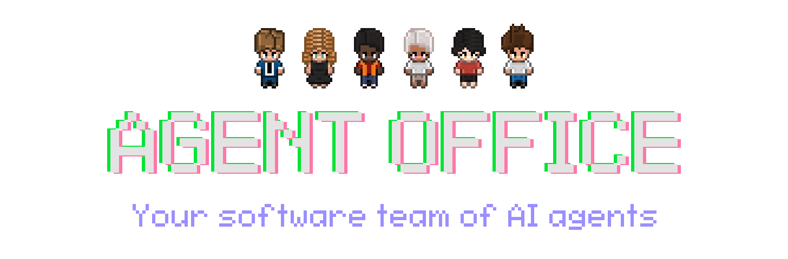
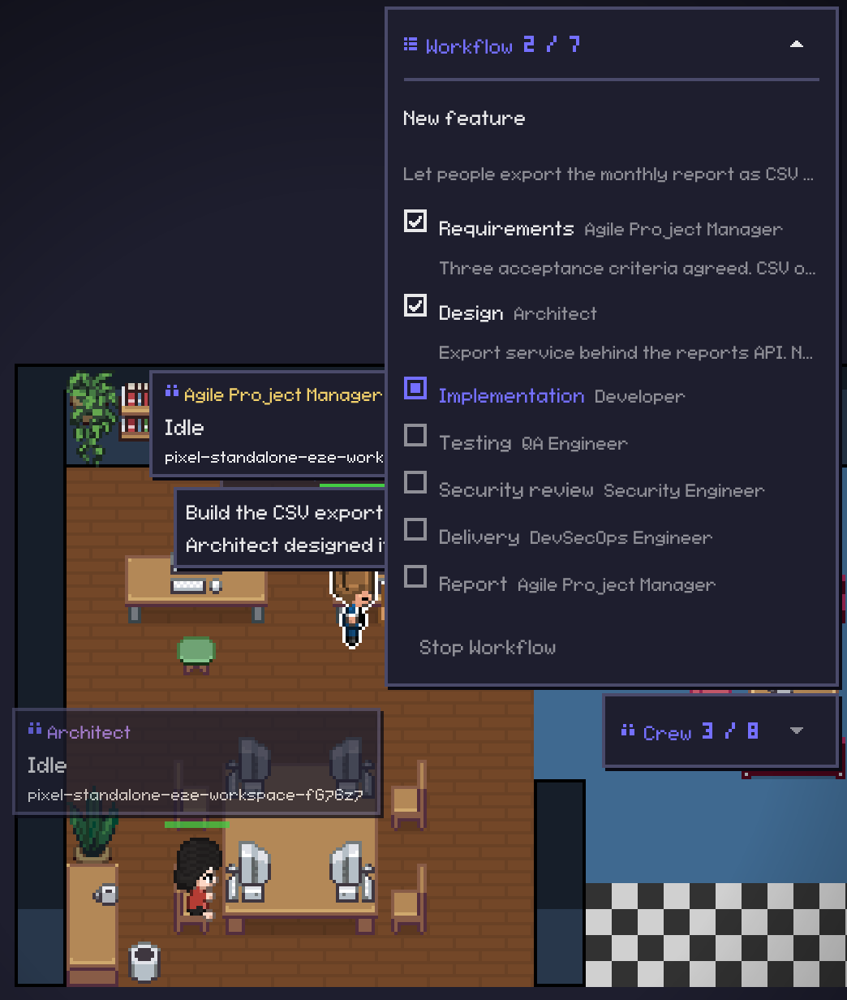

<h1 align="center">
  <a href="https://github.com/axellab/oficina-agentica">
    
  </a>
</h1>
<div align="center">

[](https://github.com/pixel-agents-hq/pixel-agents)
[](https://github.com/axellab/oficina-agentica/actions/workflows/ci.yml)
[](https://github.com/axellab/oficina-agentica/commits/main)
[](https://github.com/axellab/oficina-agentica/stargazers)
[](LICENSE)

</div>

<div align="center">
<a href="docs/roles.md">🎭 Roles</a> • <a href="docs/playbooks.md">🧰 Playbooks</a> • <a href="docs/workflows.md">🔁 Workflows</a> • <a href="docs/roles.md#a-crew-agents-free-to-work-together">🤝 Crews</a> • <a href="#pixel-office-mcp">🧩 Pixel Office MCP</a> • <a href="#built-on-pixel-agents">👾 Pixel Agents</a> • <a href="CONTRIBUTING.md">🛠️ Contributing</a>
</div>

<br/>

Agent Office is a software team of AI agents that you run from a pixel-art office. Each agent comes in with a **Role** from the software lifecycle (Architect, Developer, QA Engineer, DevSecOps Engineer, Security Engineer, Cloud Engineer, or the Agile Project Manager that coordinates them), a **Contract** that says what it takes, what it delivers and what it never does, and **Playbooks** with the tools of its trade. Hand the team one request and a **Workflow** takes it stage by stage, each stage with the Role that owns it; set a **Crew** free and its agents call each other in and work together, while you watch them do it and can stop them at any moment.

Inside it runs [Pixel Agents](https://github.com/pixel-agents-hq/pixel-agents), the open-source project it is [built on](#built-on-pixel-agents): the office where the AI coding agents in your terminals become animated characters that walk to their desks, type when they're editing files, read when they're searching, and flag you when they're stuck waiting for input, and where you launch them, pick their character, and see how much context they have left. Agent Office keeps all of that and goes somewhere else with it: from watching agents work to giving a team its work.

It runs in two forms from the same codebase, both built from this repository (see [Getting Started](#getting-started)):

- **Standalone, in the browser** — a local server that serves the office as a browser app, with the agents in an embedded terminal. Everything is here, Crews and Workflows included.
- **VS Code extension** — agents launch into VS Code terminals; characters render in the panel area. Roles come with their Contracts and Playbooks; Crews and Workflows are in the browser office only for now.

It runs Claude Code today, on your own plan. Agent Office is not published to npm or the Marketplaces: the `pixel-agents` package and extension you find there are Pixel Agents itself, without the team.


## Features

- **One agent, one character** — every agent terminal gets its own animated character
- **Roles** — launch an agent as an Architect, Developer, QA, DevSecOps, Security or Cloud Engineer, or as the Agile Project Manager that coordinates them; each gets its own standing instructions and its Contract (what it takes, delivers and never does), all plain Markdown you can read, and you can change them or add your own
- **Playbooks** — each Role's own procedures with the tools they run, handed to its agents as skills: the DevSecOps Engineer troubleshoots a failing pipeline (reading [Pipeline Doctor](https://github.com/maikadevops-labs/pipeline-doctor)'s report where your repository has it), the Security Engineer models threats and reviews for vulnerabilities, the Cloud Engineer reviews infrastructure code and its cost, and so on for all seven
- **Crews** — set a team free for one piece of work: its agents launch and message each other without asking you, inside limits the office enforces, and you watch it and end it from the office
- **Workflows** — hand one request to the team: pick the kind (new feature, bug fix, deep security analysis, deep quality analysis, sprint planning, a Role's own such as pipeline troubleshooting, a threat model or a full regression, or yours), write what you need, and a Crew takes it stage by stage, each stage with the Role that owns it, while the office shows you where it stands
- **Live activity tracking** — characters animate based on what the agent is actually doing (writing, reading, running commands). Sub-agents and teammates show up as their own characters
- **Notifications** — speech bubbles, plus optional chimes, when an agent needs input or permission or finishes its turn
- **Office layout editor** — design your office with floors, walls, furniture, and named Areas; layouts are saved across windows, export as JSON, and take external asset packs
- **Your own team** — design your agents: a wardrobe of bodies, hair, clothes and accessories, colour pickers, a pixel editor, and custom items. The pixel art is based on the amazing work of [JIK-A-4, Metro City](https://jik-a-4.itch.io/metrocity-free-topdown-character-pack).
- **In the browser and on your phone** — the standalone office launches agents into an embedded terminal. On a phone, via Tailscale, it can become an app with the office and the terminal a swipe apart
- **Recent conversations** — past sessions listed per Directory, resumed with one click as the character they had
- **Usage and context bars** — health bars for your plan limits, and one on every agent for the context it has left
- **Office radio** — procedural 8-bit background music with moods and shareable song codes
- **Agents that work the office** — with the [Pixel Office MCP](#pixel-office-mcp), agents you launch can see the office, rearrange it, launch helpers and message each other, and you watch them walk over to do it
- **A hands-on tutorial** — at the end of the first-run Intro, [the greeter, Byte, can become a real agent](#the-tutorial) and show you around the office

<p align="center">
  
</p>

## Requirements

- [Claude Code CLI](https://docs.anthropic.com/en/docs/claude-code) installed and configured
- Git and Node.js 22 (the version in [`.nvmrc`](.nvmrc)) to build it
- **VS Code extension:** VS Code 1.105.0 or later
- Windows, Linux, or macOS

## Getting Started

Agent Office runs from a build of this repository:

```bash
git clone https://github.com/axellab/oficina-agentica.git
cd oficina-agentica
npm ci
npm run build
```

The standalone office and the VS Code extension can run side by side: both share the office layout but keep separate agents and settings.

The engine inside keeps Pixel Agents' names, so you will meet them along the way: the command prints `pixel-agents` in its help, the VS Code panel is called **Pixel Agents**, and its data lives under `~/.pixel-agents/`. If you also use the published Pixel Agents, it shares that folder (layout, characters, settings, hook scripts) with this build.

### Standalone, in the browser

Start the office from the folder you built it in:

```bash
node dist/cli.js
```

It prints a local URL. Click **+** to open the drawer of Directories: add one with **+ Directory**, or turn on **Settings → Show Start Directory** to list the folder you started in. Pick a Directory to launch Claude Code in the browser's embedded terminal (on a phone, tap the **+** card); press the **Role** row first to launch it as a [Role](#roles). Sessions started in your own terminal show up too.

Use a fixed address or port when needed:

```bash
node dist/cli.js --port 3100
node dist/cli.js --host 127.0.0.1 --port 3100
node dist/cli.js --no-terminal
node dist/cli.js --help
```

The printed URL carries a `?token=`. Without it you can watch the office in a sort of read-only mode: no agents can be launched, terminals are not shown, and layout and settings cannot be edited. The token is kept in `~/.pixel-agents/standalone-token`, so a bookmark keeps working if you also fix `--port`. Treat the URL as a secret: whoever holds it can do all of the above.

### VS Code extension

1. Package the build and install it:

   ```bash
   npx @vscode/vsce package --allow-star-activation --out agent-office.vsix
   code --install-extension ./agent-office.vsix --force
   ```

   It installs under Pixel Agents' extension id, so it takes the place of the Marketplace extension if you have that one.

2. Run **Developer: Reload Window**, then open the **Pixel Agents** panel beside the terminal.
3. Click **+** (bottom left) to open its drawer of **Directories**, then click one to launch Claude Code in it. The drawer is empty at first: turn on **Settings → Show Workspace Folders**, or add a folder with **+ Directory** (see [Directories](#directories) below).

To use Claude with `--dangerously-skip-permissions`, turn on **Settings → Skip Permissions**. It stays on for every agent launched from that host until you turn it off. Only use this when you accept the security implications.

The office also detects Claude sessions started outside the extension. Turn on **Settings → Watch All Sessions** to include sessions from other workspaces.

### On your phone, via Tailscale

1. Install [Tailscale](https://tailscale.com/download) on the computer running Agent Office and on your phone, both signed in to the same tailnet.
2. Start the server on a fixed port, allowing the computer's tailnet name:

   ```bash
   node dist/cli.js --port 3100 --allowed-host my-computer.my-tailnet.ts.net
   ```

3. Serve it to your tailnet over HTTPS:

   ```bash
   tailscale serve --bg 3100
   ```

4. On your phone, open `https://my-computer.my-tailnet.ts.net/?token=…` (the `?token=` from the URL the CLI printed) and add it to the home screen. The fixed port keeps that shortcut working across restarts.

Only devices on your tailnet can reach it.

## Customizing the Office

### Layout

Click **Layout** to edit the office: paint floors, walls and carpets, place and recolour furniture, add pets you can click on, and paint named **Areas** that a Directory's agents prefer to sit in. Layouts can be exported and imported as JSON. The default office comes with two Areas, Studio and Lounge.

### Office assets

Use **Settings → Add Asset Directory** to load external characters, pets, and furniture. See [docs/external-assets.md](docs/external-assets.md) for furniture directory structure and manifest details. The visual asset manager at `scripts/asset-manager.html` helps create furniture manifests.

### Directories

A Directory is a folder you launch agents into. Click **+** to open the drawer, then **+ Directory** to add one: a name, a path (suggested from your past Claude Code sessions), and optionally the Areas its agents should sit in and the characters they wear by default. The pencil on a row you added edits or deletes it; on a phone, long-press the row.

Your workspace folders (VS Code) or the directory the CLI started in (standalone) are listed too once you turn on **Settings → Show Workspace Folders** or **Show Start Directory**.

### Roles

A Role is the part an agent plays in the team. In the launch drawer, press the **Role** row, pick one (Architect, Developer, QA Engineer, DevSecOps Engineer, Security Engineer, Cloud Engineer, Agile Project Manager), then pick the Directory: the agent starts with that Role's instructions and wears its name on its label. To change what a Role is told, give it a model, or add Roles of your own, write `~/.pixel-agents/roles.json`. Where you allowed the Pixel Office MCP, the Roles also see who is in the office, message each other, and the Agile Project Manager can launch a missing Role once you agree. See [docs/roles.md](docs/roles.md).

Each built-in Role is a folder of Markdown in [`roles/`](roles): its definition, its **Contract** (what it accepts, delivers, when it is done, what it never does, whom it hands over to) and its **Playbooks**, procedures with exact commands that its agents get as skills. Every Role has its own (the DevSecOps Engineer's Pipeline troubleshooting, the Architect's Technical design, the QA Engineer's Flaky test hunt, fifteen in all). A Playbook checks its tools first and never installs one: a missing tool is reported to you. None applies infrastructure, opens an account or writes to your tracker without your word. See [docs/playbooks.md](docs/playbooks.md).

To let a team run on its own, turn on the drawer's **Crew** switch before you launch: that agent and the ones it launches (up to 8) call each other in and work together without asking you for each step. Their marks and the Crew panel show who launched whom, and **End Crew** stops it. See [A Crew](docs/roles.md#a-crew-agents-free-to-work-together).

### Workflows

A Workflow takes one request through its stages, each owned by a Role. In the launch drawer, press the **Workflow** row and pick the kind of request (**New feature**, **Bug fix**, **Deep security analysis**, **Deep quality analysis** and **Sprint planning**, led by the Agile Project Manager, or one of the two or three each Role leads itself, such as the DevSecOps Engineer's **Pipeline troubleshooting** or the Security Engineer's **Threat model**), pick the Directory, then write what you need and press **Start**. The Workflow's lead comes in with a Crew, hands each stage to the Role that owns it (launching the ones it needs) and reports each stage as it goes; the **Workflow** panel shows every stage's state and the note it was closed with, and **Stop Workflow** ends the run. To change the stages or add Workflows of your own, write `~/.pixel-agents/workflows.json`. See [docs/workflows.md](docs/workflows.md).

<p align="center">
  
</p>

### Characters

Open the roster from the arrow beside **+** and press a character's pencil (or **+ New**) to open the **Characters** view. Dress a character from the wardrobe tabs, recolour any piece, and touch up pixels in the editor; a piece you redraw can be saved as a custom item for the rest of the cast. Nothing changes in the office until you press **Save**. Characters export as a PNG or a config file, and the whole roster as a zip.

Picking a character in the roster and then a Directory launches an agent as that character. In a Directory's settings you can also list its default characters, so its agents are recognisable at a glance.

## Pixel Office MCP

The **Pixel Agents Office MCP** (Pixel Office MCP for short) lets the agents you launch from the office see and act on it. An agent can list who else is working and what they are doing, read and rearrange the office, launch a helper into another Directory with a first instruction, read another agent's terminal and message it, and close agents when the work is done. You see it happen in the office: a character walks over to the agent it messages and says the gist in a speech bubble, an agent sent on a visit walks to the spot, and a layout edit builds outward from where the editing agent's character stands.

### Turning it on

- **The Intro asks.** The first-run tour's choices step has a box for it (off to start) beside the live updates and usage bars ones; if you finished the tour before it existed, the greeter asks this one alone. Unanswered means no: agents launched meanwhile get nothing.
- **Settings → Pixel Office MCP** turns it on or off at any time. Off takes effect at once, also for agents already running.
- **Settings → Pixel Office MCP Read-only** lets agents look (list agents, read the layout, the catalogue and terminals) but not change anything, launch, close or message. Also at once.

Ask an agent in plain words — "start an agent in the api repo to review the README", "tell agent 3 the tests pass", "make a room for the docs repo" — and it picks the tools.

### What it never does

- **Nothing is installed.** Nothing is written to your `~/.claude` files. The office adds `--mcp-config <file>` to the agents it launches or resumes, so agents started outside the office (in your own terminal, or adopted by Watch All Sessions) never get it.
- **Each agent has its own key.** The file, readable only by you under `~/.pixel-agents/mcp/`, holds the server address and a key made for that one agent. It stops working when the agent leaves, when the server stops, or when you turn the feature off — and it is never the server token in your browser's URL. Agents kept alive across a `--pty-host` restart need a resume to get access back.
- **Claude Code still asks.** Its own MCP permission prompts apply in the agent's terminal, so you can approve risky calls there.
- **A read-only office stays read-only.** A browser without the token can't reach any of it.
- **Your unsaved work wins.** Layout edits wait while someone has unsaved changes in the layout editor, and undoing an agent's edit is refused once the layout has changed since.

### Tools

| Tool                  | What an agent can do                                                                                                                                                                                        |
| --------------------- | ----------------------------------------------------------------------------------------------------------------------------------------------------------------------------------------------------------- |
| `list_agents`         | See every agent: id, nickname, Directory, Worktree, status, activity, sub-agents, context left, conversation title, team, seat and Area, character, whether it can be messaged, and which one is itself     |
| `get_layout`          | Read the office: a summary of Areas, seats and furniture by default, or the furniture list, or a tile map                                                                                                   |
| `list_catalog`        | See what can be placed: furniture, floor patterns, wall sets, carpets, pets                                                                                                                                 |
| `edit_layout`         | Change the office in one all-or-nothing batch: furniture, floors, walls, erase, carpets, pets, Areas and their Directories, grid size                                                                       |
| `undo_layout_edit`    | Undo the last agent layout edit (also a button in the layout editor: "Undo <agent>'s edit")                                                                                                                 |
| `visit`               | Walk a character to a tile or next to a piece of furniture, briefly or to stay until its agent has work                                                                                                     |
| `launch_agent`        | Launch an agent into a Directory with a first message, character, seat, nickname, new Worktree, model or permission mode, or resume a past conversation (skipping permissions only when Settings allows it) |
| `close_agent`         | Close an agent, answering the Worktree question if its Worktree has uncommitted files                                                                                                                       |
| `read_agent_terminal` | Read another agent's terminal screen                                                                                                                                                                        |
| `send_message`        | Type text (tagged with who sent it) or press keys (to answer a prompt or a menu) in other agents' terminals, refused if their screen changed since it was read                                              |
| `list_roles`          | See the Roles an agent can be launched as, who in the office holds each one, and each Role's Playbooks                                                                                                      |
| `workflow`            | Read the request and the stages of the Workflow its Crew is running; its lead starts, finishes and skips the stages, in the order the office keeps                                                          |
| `get_feature_guide`   | Read what Pixel Agents does, feature by feature, to answer your questions about the office accurately                                                                                                       |
| `tutorial`            | The tutorial's quests and progress; its Guide also gets its skill's name (the brief on request) and skips a quest when you ask it to. Quests tick when the office sees them                                 |

In VS Code there is no screen to read: `read_agent_terminal` gives an agent's status only, and `send_message` types text only, and only to agents that are done or working. `launch_agent` and `close_agent` aren't offered in VS Code yet: agents there are launched and closed from the office.

### The tutorial

The Intro's last step offers a guided tour, saying up front what yes does, because the tour is run by a **real Claude Code session**: the greeter (Byte, unless you renamed that character) walks to a free desk, sits down, and becomes an agent with its own terminal and card. It tells you what Pixel Agents is, then asks whether you'd like to try something in particular or be shown around. It uses your plan like any session you start. It needs the Pixel Office MCP on, and you can start it later from **Settings → Play the Tutorial**.

- **Four first steps, in any order**: create your first character, add a project (a Directory), put an agent to work, and make the office yours. Each ticks itself off when the office sees it happen. Along the way Byte offers more (an Area for your Directory, default characters, resuming conversations, what agents can do through the Pixel Office MCP), and it stays around once you're done.
- **A checklist** sits collapsed at the top right; open it to see progress, **Skip** a step, or **Quit** at any time: quitting closes Byte's session. Once every step is done it says so and goes away.
- **How Byte knows what to do**: an onboarding skill, loaded for that one session with `--plugin-dir` from a folder under `~/.pixel-agents` (nothing is installed into `~/.claude`).
- **What Byte may do**: read the office without asking (its read-only tools are pre-approved for this one session). It runs in Claude Code's auto mode, even when Settings skips permissions: safe actions go ahead, and anything risky waits for Claude Code's own permission prompt in its terminal. It launches into the folder `pixel-agents` was started in (VS Code: the first workspace folder).

## Where This Is Going

Pixel Agents set out to make running agents feel less like administration and more like play. Agent Office keeps the play and points it at one thing: a software team you can hand real work to, and see doing it.

Three things get there, and they are happening in parallel, not in sequence:

- **A team with a shape.** Every Role with its definition, its Contract and its own Workflows in plain Markdown, so the team can be read, reviewed and changed like code, and a new Role follows the same structure as the seven that ship.
- **The tools of each trade.** Playbooks that run what each Role really works with (scanners, linters, pipeline diagnosis, infrastructure and cost checks) and report evidence, never installing a tool, applying infrastructure or opening an account on their own.
- **Work that moves by itself, in plain sight.** Crews and Workflows that take a request from requirements to delivery without you approving each step, inside limits the office enforces, while you see who is doing what and can stop it at any moment.

It is early. Roles, Playbooks, Crews and Workflows are covered by the test suite against a stand-in for Claude Code and are still being proven with real sessions, and Crews and Workflows come to VS Code after the browser. See [CONTRIBUTING.md](CONTRIBUTING.md) to jump in.

## How It Works

The office follows Claude Code through two detection paths, both Pixel Agents' own:

- **Hooks mode** (default) — a hook script receives Claude events such as `SessionStart`, `PreToolUse`, `PermissionRequest`, and `Stop`. It discovers the active servers and sends authenticated events to each one.
- **Heuristic mode** (fallback) — when hooks are unavailable, the runtime infers agent status by scanning Claude's JSONL session transcripts under `~/.claude/projects/`. Transcripts are also read in hooks mode for details not present in an event.

The team sits on top of that. A Role is a folder of Markdown under [`roles/`](roles): when you launch an agent as one, the office hands that session its instructions and Contract as a system prompt file and its Playbooks as skills, and the [Pixel Office MCP](#pixel-office-mcp) is how the agents see and call each other. What a Crew may reach and the order of a Workflow's stages are enforced by the server, not left to what an agent was told.

Agent Office does not modify Claude Code. Its hook configuration and persistent data live under `~/.claude/` and `~/.pixel-agents/` respectively. The usage bars are opt-in (**Settings → Usage Bars**): Claude Code reports plan limits only to its status line, so turning them on wraps your `statusLine` command in `~/.claude/settings.json` (yours keeps running unchanged), and turning them off restores it.

## Development

To run the tests, work with live rebuilds, or add support for another agent CLI, see [CONTRIBUTING.md](CONTRIBUTING.md). It covers setup, the project structure, how an event reaches the office, the asset format, and the hosted test reports; it was written for Pixel Agents and holds here, with this repository's address in place of that one. The end-to-end suite is described in [e2e/README.md](e2e/README.md), the project's vocabulary in [CONTEXT.md](CONTEXT.md).

## Troubleshooting

- **Standalone will not start:** verify your Node.js version and that `npm run build` finished, omit `--port` to choose a free port, or select another fixed port.
- **An agent is missing:** confirm **Settings → Instant Detection (Hooks)** is on and that the session belongs to the current workspace. Enable **Watch All Sessions** if needed.
- **The UI looks disconnected:** open **Settings → Debug View** to inspect the server connection, transcript path, and latest agent data.
- **Extension and standalone are both running:** this is supported. Current versions create separate files under `~/.pixel-agents/servers/`; stopping one does not remove the other.
- **A Role's agent says a tool is missing:** that is its Playbook checking before it runs anything. Playbooks never install a tool: install the one it names and ask again, or tell the agent to go on without it.

## Community & Contributing

Agent Office is developed in the open in [this repository](https://github.com/axellab/oficina-agentica), and pull requests are welcome. See [CONTRIBUTING.md](CONTRIBUTING.md) before opening one and read our [Code of Conduct](CODE_OF_CONDUCT.md) before participating.

The office inside has a community of its own: join the Pixel Agents [Discord](https://discord.gg/Yk7jXebv9H) to chat with its users and follow its development.

## Supporting the Project

Agent Office stands on the work of [Pablo De Lucca](https://github.com/pablodelucca) and the Pixel Agents contributors. If the office makes your day better, support them:

<a href="https://github.com/sponsors/pablodelucca">
  
</a>
<a href="https://ko-fi.com/pablodelucca">
  
</a>

## Built on Pixel Agents

Agent Office started as a fork of [Pixel Agents](https://github.com/pixel-agents-hq/pixel-agents) ([pixel-agents.com](https://pixel-agents.com)) and keeps it whole inside, among the other things it is made of:

- **What Pixel Agents brings** — the office and how it is drawn, the characters and their wardrobe, the layout editor, the detection of agents through hooks and transcripts, the standalone server and the VS Code extension, the embedded terminal and the phone shell, the usage and context bars, the radio, the Pixel Office MCP and the tutorial.
- **What Agent Office adds** — the seven Roles with their Contracts, their fifteen Playbooks and the tools those run (among them [Pipeline Doctor](https://github.com/maikadevops-labs/pipeline-doctor), read where your repository has it), Crews, the eighteen Workflows, one per kind of request, and the tools and office panels that go with them.

## License

Agent Office is available under the [MIT License](LICENSE), as Pixel Agents is, and keeps its copyright notice.
