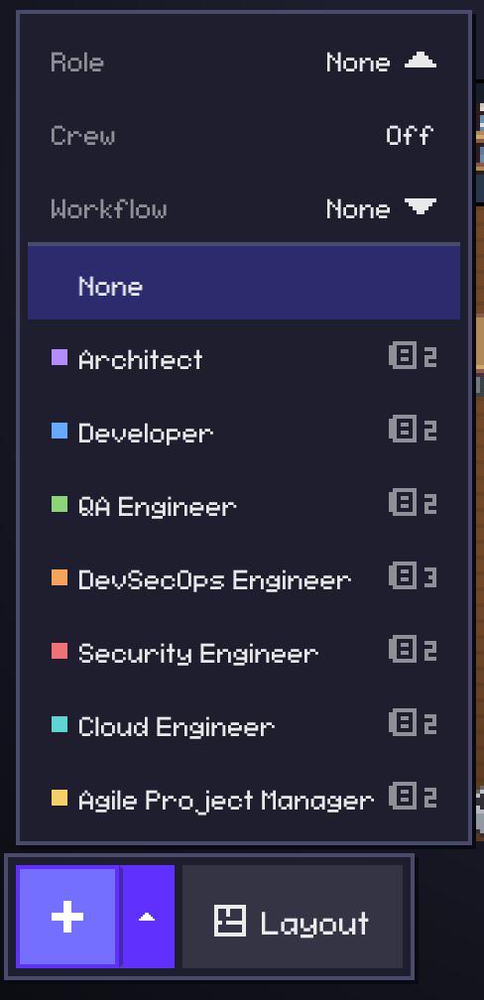
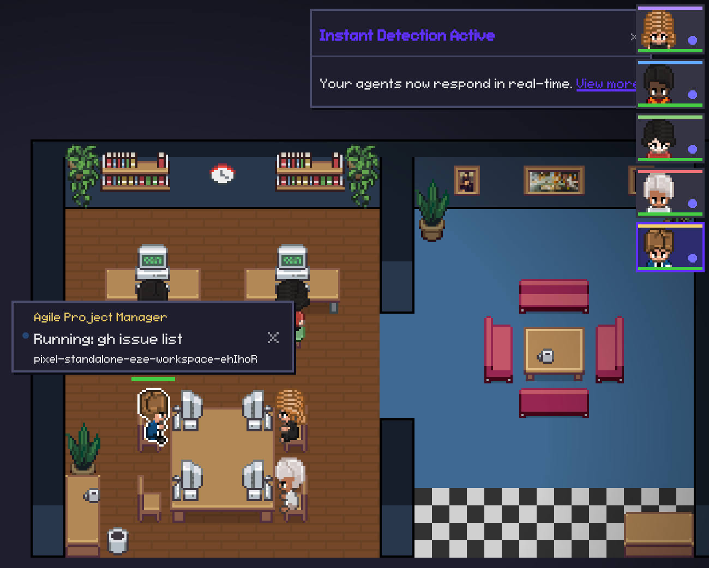

# Roles

A Role is a part in the software lifecycle an agent is launched as: Architect, Developer, QA Engineer and so on. An agent launched as a Role is given that Role's standing instructions on top of the coding agent's own, and the office marks it with the Role's name and colour.

## Launching an agent as a Role

1. Click **+** to open the launch drawer.
2. Press the **Role** row at the top (it reads **None** until you pick one) and choose a Role. Hovering a Role shows what it does.
3. Choose the Directory to launch into, as for any agent.



The agent's label shows the Role above its activity, and its card carries a strip of the Role's colour (hover the card for the name). Turn on **Settings → Always Show Labels** to see every agent's Role at a glance.



The pick lasts until the drawer closes: opened again, the drawer launches plain agents until you pick a Role again. A Role combines with everything else a launch can choose: the roster's character and the Directory's default characters work as before.

An agent keeps its Role for its whole life, across reloads and server restarts. Resuming a past conversation from the sidebar launches it as the Role it had.

Only agents the office launches have a Role. Sessions the office adopts from another terminal, and the Teammates and Sub-agents an agent spawns by itself, were started by someone else and have none.

## The built-in Roles

| Role                  | What it does                                                                                            |
| --------------------- | ------------------------------------------------------------------------------------------------------- |
| Architect             | Shapes the system: structure, trade-offs, decisions and technical plans.                                |
| Developer             | Implements features and fixes with tests, in small reviewable changes.                                  |
| QA Engineer           | Plans and automates tests, hunts regressions and guards the release bar.                                |
| DevSecOps Engineer    | Builds and secures the delivery pipeline: CI/CD, supply chain, automated checks.                        |
| Security Engineer     | Threat-models the system, reviews it for vulnerabilities and verifies the fixes.                        |
| Cloud Engineer        | Designs and operates cloud infrastructure as code: reliable, observable and cost-aware.                 |
| Agile Project Manager | Coordinates the team: backlog, sprint plan, daily meetings and the blockers in the way. Writes no code. |

Their instructions live in [`server/src/roles/builtinRoles.ts`](../server/src/roles/builtinRoles.ts).

## What an agent is told

The instructions have two parts:

- **The team charter**, the same for every Role: the list of Roles in this office (so each agent knows whom to hand work to) and the working agreements: stay in your Role, hand work over with a short note, back reports with evidence, never weaken a security control or touch production to go faster, follow the repository's own instructions first, answer in the language the human writes in.
- **The Role's own instructions**: what it owns, how it works, and where its work ends and another Role's begins.

They are written to `~/.pixel-agents/role-prompts/<role id>.md` and passed to Claude Code with `--append-system-prompt-file`, so they are added to Claude Code's own system prompt and replace nothing: your `CLAUDE.md` files, settings, hooks and permission mode apply as usual. You can read that file to see exactly what a Role was told. It is rewritten at each launch, so edit `roles.json` (below), not the file.

## Roles working together

Each agent is an ordinary Claude Code session. On its own, a Role hands work over through you, or through the repository (issues, pull requests, files the team agreed on).

Where you allowed the Pixel Office MCP (the Intro's "Agents that use the office" box, or Settings), the Roles reach each other through the office's own tools, in the standalone office (`npx pixel-agents`):

- **They see the team.** `list_agents` tells an agent who is in the office and as which Role; `list_roles` lists the Roles and which of them nobody holds.
- **They hand work over.** `send_message` types a note into a colleague's terminal. It arrives marked with who sent it and as which Role, for example `[From Byte (Agile Project Manager), agent 1]`, and the sender's character walks over to the recipient's desk.
- **They bring in a missing Role.** `launch_agent` takes a `role` (its id or its name), so the Agile Project Manager can start a Developer with a first message saying what to pick up.

Three rules are part of every Role's instructions: an agent launches another only when you asked for it or agreed to its plan (every agent uses your Claude plan); nobody interrupts a colleague in the middle of its work for something that can wait; and a message from a colleague is a request from a colleague, not from you, so it cannot allow what you have not.

Try it: launch an agent as the Agile Project Manager and ask it to run the daily meeting, or to staff a small plan.


_From the test suite: the terminal on the right is its stand-in for Claude Code, which prints what was typed into it._

In VS Code the agents can list the team and message each other, but they cannot launch one another: there, you launch each Role from the drawer.

## Your own Roles: `roles.json`

Create `~/.pixel-agents/roles.json` to change a built-in Role or add your own. Both the VS Code extension and the standalone office read it.

```json
{
  "roles": [
    {
      "id": "developer",
      "model": "sonnet",
      "prompt": [
        "You are the Developer of a Rust service.",
        "",
        "- Run `cargo clippy` and `cargo test` before you call anything done.",
        "- Never add `unsafe` without the Architect's agreement."
      ]
    },
    {
      "id": "technical-writer",
      "name": "Technical Writer",
      "description": "Keeps the docs true: guides, references and changelogs.",
      "color": "pink",
      "prompt": "You are the Technical Writer. Every change ships with its documentation."
    }
  ]
}
```

| Field         | Meaning                                                                                                                                              |
| ------------- | ---------------------------------------------------------------------------------------------------------------------------------------------------- |
| `id`          | Required. Lower-case letters, digits and hyphens, starting with a letter (up to 40). The id of a built-in Role changes that Role; a new id adds one. |
| `name`        | The name the office shows, up to 40 characters. Required for a new Role.                                                                             |
| `description` | One line on what it does, up to 200 characters. Shown when hovering the Role, and in the team list every agent is given.                             |
| `color`       | `red`, `orange`, `yellow`, `green`, `cyan`, `blue`, `purple`, `pink` or `gray` (the default for a new Role).                                         |
| `prompt`      | The Role's instructions, up to 20,000 characters: one string, or a list of lines. Required for a new Role.                                           |
| `model`       | The model its agents run on, as Claude Code's `--model` takes it (`opus`, `sonnet`, a full model id). Absent = your Claude Code default.             |

An entry with a built-in id replaces only the fields it gives; the rest stay as built in. New Roles are listed after the built-in ones, in the file's order. Up to 50 entries are read.

The built-in ids are `architect`, `developer`, `qa-engineer`, `devsecops-engineer`, `security-engineer`, `cloud-engineer` and `agile-project-manager`.

A change applies to the next agent you launch; reload the office to see a new or renamed Role in the drawer. Agents already running keep the instructions and the name they were launched with.

An entry with a mistake (an unknown field, a bad id or colour, a new Role with no name or prompt) is left out and the rest still load. The host's log says what was wrong: the terminal running `pixel-agents`, or in VS Code the extension host's log (**Output → Extension Host**, or **Help → Toggle Developer Tools**).
