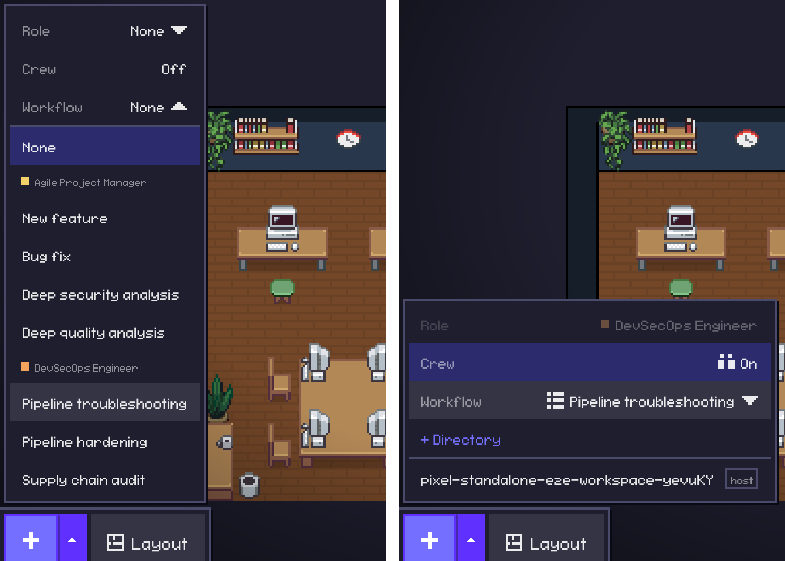
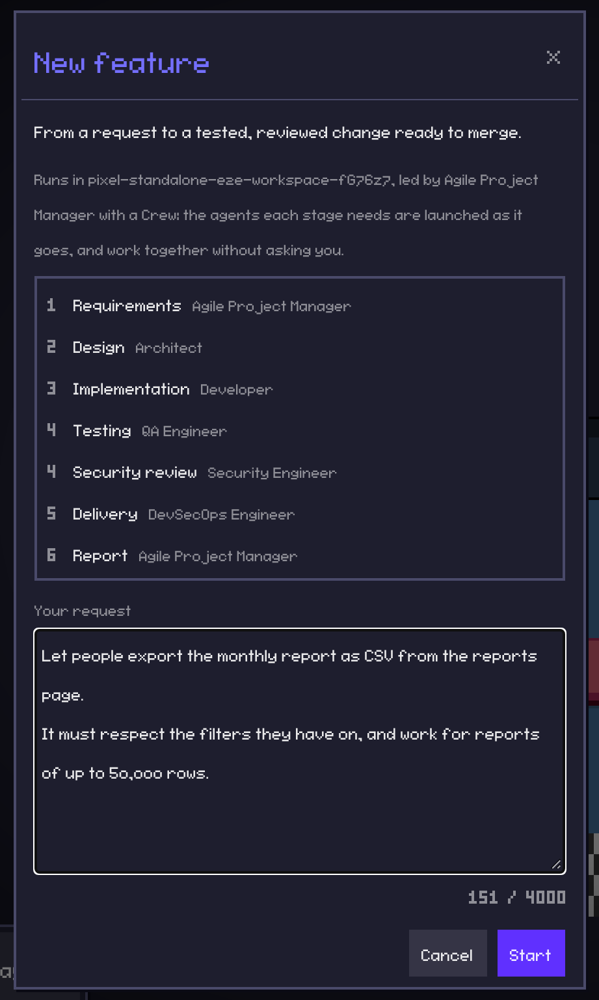
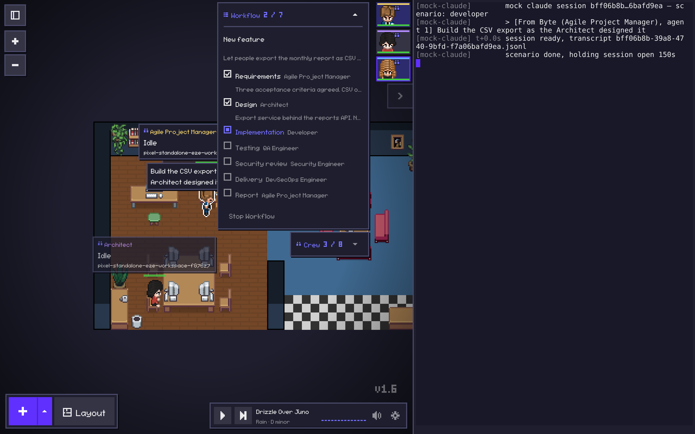

# Workflows

A Workflow is how one kind of request is handled: an ordered list of stages, each owned by a [Role](roles.md). You pick the Workflow that fits what you need, write the request in your own words, and a [Crew](roles.md#a-crew-agents-free-to-work-together) takes it from there: its lead hands each stage to an agent of the Role that owns it, and the office shows you every stage as it moves.

Every Workflow is led by one Role. The four general ones are led by the Agile Project Manager, who coordinates the whole team; a Role can also lead Workflows of its own, for the requests that are its speciality. You can write your own too.

| Workflow                     | Led by                | For                                                                         |
| ---------------------------- | --------------------- | --------------------------------------------------------------------------- |
| **New feature**              | Agile Project Manager | From a request to a tested, reviewed change ready to merge.                 |
| **Bug fix**                  | Agile Project Manager | Reproduce a bug, find its cause, fix it and prove it stays fixed.           |
| **Deep security analysis**   | Agile Project Manager | A threat model and a ranked list of security findings, with evidence.       |
| **Deep quality analysis**    | Agile Project Manager | How healthy the code, its tests and its pipeline are, with a ranked plan.   |
| **Pipeline troubleshooting** | DevSecOps Engineer    | Why a pipeline that passed now fails, and a fix proven by a green run.      |
| **Pipeline hardening**       | DevSecOps Engineer    | The pipeline reviewed for mistakes and for abuse, and hardened on a branch. |
| **Supply chain audit**       | DevSecOps Engineer    | What the code is built from, what in it is vulnerable, unpinned or leaked.  |

## Starting a run

1. Click **+** to open the launch drawer.
2. Press the **Workflow** row (under **Crew**; it reads **None** until you pick one) and choose a Workflow. They are listed under the Role that leads them. The **Role** row now names that Role and **Crew** reads **On**: a run is always a Crew led by the Workflow's own Role, so neither is yours to set.
3. Choose the Directory the work happens in.
4. The office shows the Workflow's stages and asks for **your request**. Write what you need as you would to a colleague, then press **Start** (or Ctrl+Enter).





Nothing launches before **Start**. The pick lasts until the drawer closes, like a Role: opened again, the drawer launches plain agents.

## What happens next

- **The lead comes in**, as the Workflow's lead Role (the Agile Project Manager for the four general ones, the DevSecOps Engineer for its own), with a new Crew. It reads your request and the stages, and asks you in its own terminal for anything the request leaves open that only you can decide.
- **It hands each stage to the Role that owns it**, launching the Roles the Crew does not have yet, without asking you: that is what a Crew is. A stage its own Role owns, it does itself.
- **The stages run in order.** A stage starts once the ones before it are done or skipped. Stages that share a number in the dialog run at the same time (a security review beside the testing, for example). When later work sends an earlier stage back (QA finds a defect), the lead starts that stage again.
- **You watch it in the office.** Every hand-over is a walk to the other agent's desk. The **Workflow** panel (top right) counts the stages closed; opened, it shows your request and each stage with its Role, where it stands, and the note the lead closed it with: what was done and how it was verified, or why the request did not need it.
- **It ends on a report.** Every built-in Workflow's last stage is the lead reporting to you in its own terminal. Nothing is merged or deployed for you: that stays your call.



_From the test suite: the terminal on the right is its stand-in for Claude Code._

The analyses (Deep security analysis, Deep quality analysis, Supply chain audit) change nothing in your project: what they deliver is the report, and fixing what they find is a new request you decide on.

A stage of a Role's own Workflow often sends its owner to one of its [Playbooks](playbooks.md): the Workflow says who does what and in which order, the Playbook says which tools to run and how.

## Stopping a run

**Stop Workflow** in the panel, asked once. The run is over and its Crew is ended: the agents keep running and keep their work, but no longer launch, message or close each other. Ending the run's Crew from the Crew panel, or closing its lead, ends the run too.

A run that reached its last stage stays in the panel, finished, until you stop it, so the notes stay there to read.

## Limits

- A run is a Crew, with a Crew's limits: at most 8 agents at a time, each on your Claude plan, reaching only each other, and only you answer a permission prompt.
- Only you start a run. No agent can start one, and only the run's lead reports its stages.
- The order is the office's, not the lead's good manners: a stage reported out of order is refused.
- A run lives in the office's memory: it does not survive a restart of `pixel-agents`.
- Workflows need the Pixel Office MCP allowed and not read-only, and an office that launches agents itself: the standalone office. Where a run cannot be started, the Workflow row is there, dimmed, and its tooltip says what is missing. The VS Code extension has none.

## The built-in Workflows

Stages with the same number run at the same time.

### New feature

| #   | Stage           | Role                  | What closes it                                                                               |
| --- | --------------- | --------------------- | -------------------------------------------------------------------------------------------- |
| 1   | Requirements    | Agile Project Manager | User stories with acceptance criteria that can be checked, and what is left out.             |
| 2   | Design          | Architect             | A technical plan that covers every story and names its risks.                                |
| 3   | Implementation  | Developer             | The plan built on a branch of its own (a new Worktree), the repository's checks passing.     |
| 4   | Testing         | QA Engineer           | Every acceptance criterion has a test or a recorded check that passes.                       |
| 4   | Security review | Security Engineer     | Each finding fixed, or accepted by you in so many words.                                     |
| 5   | Delivery        | DevSecOps Engineer    | The pipeline passes and the branch is ready for you to merge. Nothing is merged or deployed. |
| 6   | Report          | Agile Project Manager | What was built and where, how each criterion was verified, what is open.                     |

### Bug fix

| #   | Stage          | Role                  | What closes it                                                                        |
| --- | -------------- | --------------------- | ------------------------------------------------------------------------------------- |
| 1   | Reproduce      | QA Engineer           | Anyone can see the bug by following the steps (a failing test where possible).        |
| 2   | Diagnosis      | Developer             | The root cause, with evidence, explains every symptom.                                |
| 3   | Fix            | Developer             | The smallest change that removes the cause, with a regression test, on a branch.      |
| 4   | Verification   | QA Engineer           | The reproduction no longer shows the bug, and nothing nearby broke.                   |
| 4   | Security check | Security Engineer     | Whether the bug could be used against the system, and whether the fix opens anything. |
| 5   | Report         | Agile Project Manager | The bug, its cause, the fix and where it is, how it was verified.                     |

### Deep security analysis

| #   | Stage                     | Role                  | What closes it                                                                     |
| --- | ------------------------- | --------------------- | ---------------------------------------------------------------------------------- |
| 1   | Threat model              | Security Engineer     | What is worth protecting, the entry points, and where to look hardest.             |
| 2   | Code review               | Security Engineer     | Every entry point of the model read; each finding with its evidence.               |
| 2   | Dependencies and pipeline | DevSecOps Engineer    | Dependencies, secrets in the repository, what the pipeline runs and as whom.       |
| 2   | Infrastructure            | Cloud Engineer        | Identities, network exposure, encryption, logging, from what the repository holds. |
| 2   | Architecture              | Architect             | Weaknesses no single file shows: misplaced trust, checks that can be bypassed.     |
| 3   | Triage                    | Security Engineer     | Duplicates dropped, every finding left ranked with a reason.                       |
| 4   | Report                    | Agile Project Manager | The findings by severity, where each is and what would fix it.                     |

A secret found on the way is reported by where it is, never copied into a note or a message.

### Deep quality analysis

| #   | Stage              | Role                  | What closes it                                                      |
| --- | ------------------ | --------------------- | ------------------------------------------------------------------- |
| 1   | Scope              | QA Engineer           | Which parts and which qualities matter, and the starting numbers.   |
| 2   | Tests              | QA Engineer           | What the suites cover and what they do not, flaky and empty tests.  |
| 2   | Code health        | Developer             | The parts hardest to change and why, dead code, lint and type debt. |
| 2   | Architecture       | Architect             | Boundaries that leak, dependencies that point the wrong way.        |
| 2   | Build and pipeline | DevSecOps Engineer    | What the pipeline verifies and lets through, how long it takes.     |
| 3   | Triage             | QA Engineer           | Every finding left has a priority and a reason, grouped into steps. |
| 4   | Report             | Agile Project Manager | The findings by priority and the first steps recommended.           |

## The DevSecOps Engineer's Workflows

Led by the DevSecOps Engineer, who does its own stages with its [Playbooks](playbooks.md) and brings in the other Roles for theirs.

### Pipeline troubleshooting

| #   | Stage           | Role               | What closes it                                                                                          |
| --- | --------------- | ------------------ | ------------------------------------------------------------------------------------------------------- |
| 1   | Evidence        | DevSecOps Engineer | The failed run, its first error, the last green run, what changed, and Pipeline Doctor's report if any. |
| 2   | Diagnosis       | DevSecOps Engineer | One cause explains the failure, with its evidence and what was ruled out.                               |
| 3   | Fix             | Developer          | For a cause in the code: the smallest change that removes it, on a branch.                              |
| 3   | Pipeline change | DevSecOps Engineer | For a cause in the pipeline: the change as code, on a branch.                                           |
| 4   | Verification    | QA Engineer        | The pipeline runs green on the branch, and nothing was skipped or silenced to get there.                |
| 5   | Report          | DevSecOps Engineer | The cause, the evidence, the fix and where it is, what is open.                                         |

Whichever of the two stages at step 3 the cause does not need is skipped, with a note. Nobody makes the pipeline green by skipping a test or turning a check off. How the Evidence stage uses [Pipeline Doctor](playbooks.md#pipeline-troubleshooting-and-pipeline-doctor) is in the Playbook.

### Pipeline hardening

| #   | Stage           | Role               | What closes it                                                                         |
| --- | --------------- | ------------------ | -------------------------------------------------------------------------------------- |
| 1   | Inventory       | DevSecOps Engineer | Every workflow with its triggers, permissions, secrets and the actions it uses.        |
| 2   | Lint and audit  | DevSecOps Engineer | Each finding of the linter, the audit and the manual review says where it is.          |
| 2   | Security review | Security Engineer  | What a pull request from outside could make the pipeline run, and reach.               |
| 3   | Changes         | DevSecOps Engineer | The fixes on a branch, one finding per commit; what needs your decision is put to you. |
| 4   | Verification    | QA Engineer        | The pipeline runs green on the branch and still runs the same tests as before.         |
| 5   | Report          | DevSecOps Engineer | The findings by severity, what was fixed and where, what waits for your decision.      |

### Supply chain audit

| #   | Stage        | Role               | What closes it                                                                          |
| --- | ------------ | ------------------ | --------------------------------------------------------------------------------------- |
| 1   | Inventory    | DevSecOps Engineer | What the repository is built from, and its bill of materials.                           |
| 2   | Dependencies | DevSecOps Engineer | Known vulnerabilities, pins, licences: each finding with its package and the fix.       |
| 2   | Secrets      | Security Engineer  | Each match in the files and the history judged, by where it is, never by its value.     |
| 3   | Triage       | Security Engineer  | Every finding left ranked by real risk in this system, with a reason.                   |
| 4   | Report       | DevSecOps Engineer | The findings by severity, the secrets to replace, the tools that ran and those missing. |

## Where the built-in Workflows live

Each is a Markdown file in the folder of the Role that leads it: `roles/<role id>/workflows/<workflow id>.md` in the repository ([`roles/`](../roles)). The front matter names it, the text before the first stage is what the lead is told about the Workflow as a whole, and each stage is a section:

```markdown
---
name: Pipeline troubleshooting
description: Why a pipeline that passed now fails, and a fix proven by a green run.
order: 10
---

The request is a pipeline run that fails. ...

## 1. Evidence (devsecops-engineer)

Run your Pipeline troubleshooting playbook, steps 1 to 4. ... Closed when all of that is in your note.

## 3. Fix (developer)

...

## 3. Pipeline change (devsecops-engineer)

...
```

A stage's heading is `## <step>. <Title> (<role id>)`: stages with the same step number run at the same time, and steps count up from 1 without a gap. The stage's id is its title in lower case with hyphens (`pipeline-change`), or the one the heading gives at its end (`{#pipeline}`). The limits are the same as in `workflows.json` below, which is also how you replace one of these or add your own without touching the repository.

## Your own Workflows: `workflows.json`

Create `~/.pixel-agents/workflows.json` to add a Workflow or replace a built-in one.

```json
{
  "workflows": [
    {
      "id": "release",
      "name": "Release",
      "description": "Cut a release: notes, version, checks, tag.",
      "lead": "agile-project-manager",
      "brief": "The request names the version. Nothing is published: the run ends with a tagged commit ready for the user to push.",
      "stages": [
        {
          "id": "notes",
          "title": "Release notes",
          "role": "agile-project-manager",
          "brief": "Write the notes from the commits since the last tag. Closed when every user-facing change is in them."
        },
        {
          "id": "checks",
          "title": "Release checks",
          "role": "devsecops-engineer",
          "brief": [
            "Run the full pipeline on the release commit.",
            "Closed when it passes, with the run's link in the note."
          ]
        },
        {
          "id": "smoke",
          "title": "Smoke test",
          "role": "qa-engineer",
          "parallel": true,
          "brief": "Install the build as a user would and walk the main paths. Closed when they all work."
        }
      ]
    }
  ]
}
```

| Field               | Meaning                                                                                                                                                           |
| ------------------- | ----------------------------------------------------------------------------------------------------------------------------------------------------------------- |
| `id`                | Required. Lower-case letters, digits and hyphens, starting with a letter (up to 40). The id of a built-in Workflow replaces that Workflow; a new id adds one.     |
| `name`              | Required. The name the office shows, up to 40 characters.                                                                                                         |
| `description`       | One line on what it is for, up to 200 characters. Shown in the request dialog and when hovering the Workflow.                                                     |
| `lead`              | The id of the Role that leads its runs. Absent = `agile-project-manager`.                                                                                         |
| `brief`             | What the lead is told about the Workflow as a whole, up to 4,000 characters: one string, or a list of lines.                                                      |
| `stages`            | Required. One to 12 stages, in order.                                                                                                                             |
| `stages[].id`       | Required. Same shape as a Workflow's id, unique within the Workflow. It is what the lead names when it reports the stage.                                         |
| `stages[].title`    | Required. The stage's name in the office, up to 60 characters.                                                                                                    |
| `stages[].role`     | Required. The id of the Role that owns the stage (a built-in one, or one of your own from [`roles.json`](roles.md#your-own-roles-rolesjson)).                     |
| `stages[].brief`    | What the stage's owner does and what closes it, up to 2,000 characters: one string, or a list of lines. The lead is told it; write it so it can check the result. |
| `stages[].parallel` | `true` when the stage may run at the same time as the stage listed before it. Not on the first stage.                                                             |

The built-in ids are `new-feature`, `bug-fix`, `security-review`, `quality-review`, `pipeline-troubleshooting`, `pipeline-hardening` and `supply-chain-audit`. An entry with one of them replaces that Workflow **whole** (its stages are a list, not fields to merge), so start from the full Workflow you want. New Workflows are listed after the built-in ones, in the file's order; the drawer shows each under the Role that leads it. Up to 30 entries are read.

A change applies to the next run you start; reload the office to see a new or renamed Workflow in the drawer. A run already under way keeps the stages it started with.

An entry with a mistake (an unknown field, a bad id, no stages, a first stage marked parallel) is left out and the rest still load, and so is a Workflow naming a Role your office does not have. The host's log says what was wrong: the terminal running `pixel-agents`.

Stages are for the lead to plan with, not a script: the lead reads your request first, and skips a stage the request does not need, with a note saying why.
